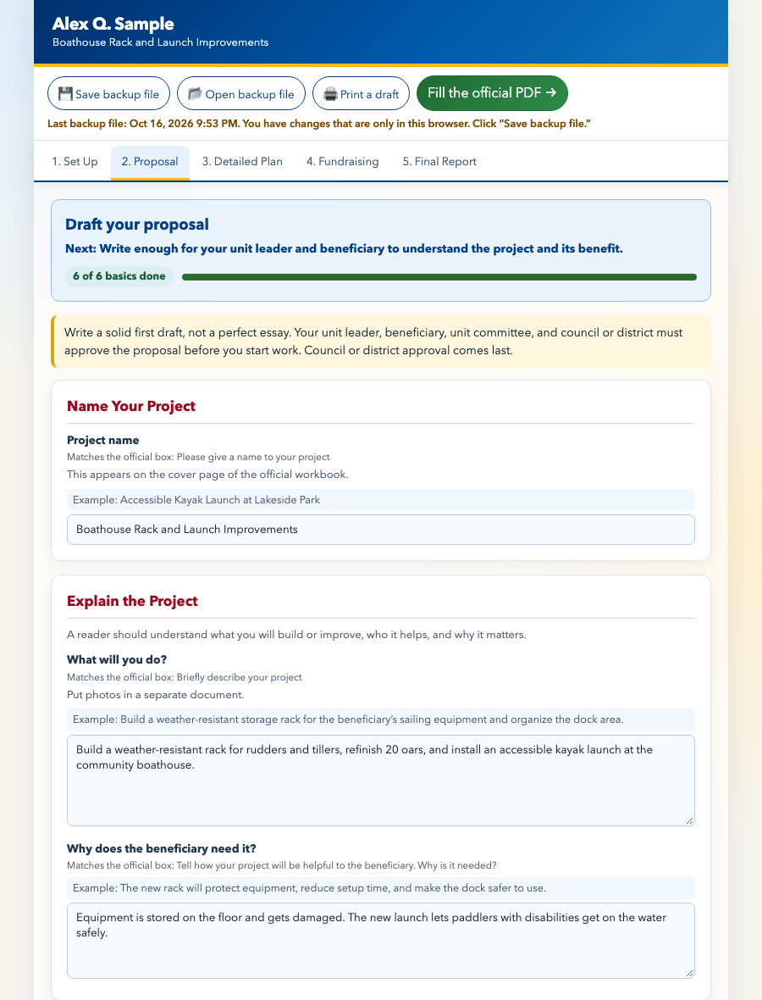
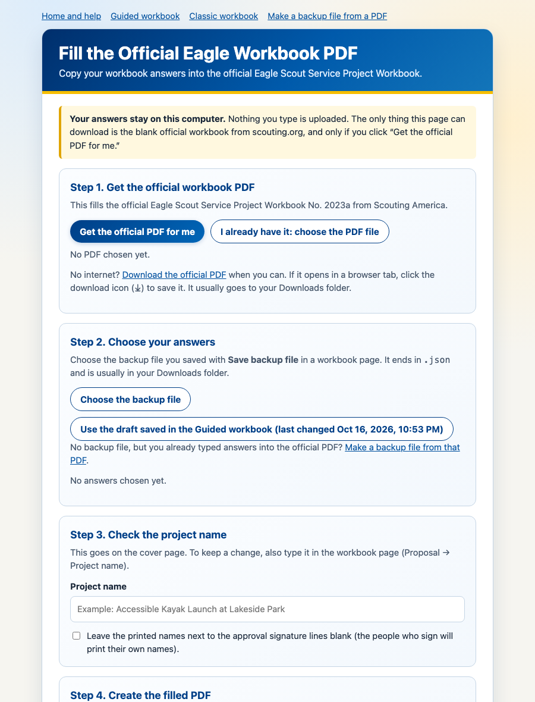

# EaglePaperworkHelper

Free, offline helpers for the **Eagle Scout Service Project Workbook**. Type your answers into a friendly web page, then copy them into the official workbook PDF in one step.

- Nothing to install. No account.
- Your answers stay on your computer. Nothing you type is uploaded.
- The finished PDF is the official Scouting America workbook, with your answers typed into its own boxes.

**Official workbook:** [Eagle Scout Service Project Workbook No. 2023a (PDF)](https://www.scouting.org/wp-content/uploads/2023/01/EagleProjectWorkbook2023a.pdf), from Scouting America’s [workbook page](https://www.scouting.org/programs/scouts-bsa/advancement-and-awards/eagle-scout-workbook/). Check that page for the current version before you submit.

> This project is not made, endorsed, or supported by Scouting America. Read the entire official workbook (and its “Message to Scouts and Parents or Guardians” with a parent or guardian). The official workbook, your council’s procedures, and the required signatures are what count.



## Quick start

1. **Download this project.** On GitHub, click the green **Code** button, then **Download ZIP**.
2. **Unzip it.**
   - **Windows:** right-click the ZIP file, choose **Extract All**, then **Extract**. (Opening files straight from inside the ZIP does not work.)
   - **Mac:** double-click the ZIP file.

   You get a folder named something like `EaglePaperworkHelper-main`. Move it somewhere easy to find, such as Documents. Keep everything in it together.
3. **Open `index.html`.** Double-click it. It opens in your web browser and links to every page. (Windows may hide the `.html` ending, so look for **index**.) Click **Guided workbook (start here)**. Bookmark it, and always use the same browser.
4. **Type your answers.** Start with **1. Set Up** and **2. Proposal**. Your draft saves automatically in this browser.
5. **Save a backup file often.** Click **💾 Save backup file**. It saves a file such as `Eagle-workbook-backup-2026-10-16-1930.json` (date and time), usually in your Downloads folder. This file is your real save: browsers can erase saved data.
6. **Fill the official PDF.** Click **Fill the official PDF →** and follow the four steps on that page.

Open the filled PDF, read every page, and share it with the people reviewing your project.

## What’s included

| File | What it is |
| --- | --- |
| [`EagleWorkbook-guided.html`](EagleWorkbook-guided.html) | **Guided workbook. Start here.** Five stages with plain-language questions, examples, running totals, and progress checks. |
| [`EagleWorkbook.html`](EagleWorkbook.html) | **Classic workbook.** The same questions, worded and ordered like the official workbook. |
| [`FillOfficialPDF.html`](FillOfficialPDF.html) | **Fill the official PDF.** Copies your answers into the official workbook PDF. |
| [`BackupFromPDF.html`](BackupFromPDF.html) | **Make a backup file from a PDF.** Already typed answers into the official PDF? This reads them back into a backup file for the workbook pages. |
| [`index.html`](index.html) | **Home page.** Short instructions and links to every page. |
| `lib/`, `vendor/`, `docs/` | Files the pages need. Don’t move or delete them. |
| `tests/`, `tools/` | For developers. Scouts can ignore these folders. |

Both workbooks use the same backup file. A backup file saved in one opens in the other with **📂 Open backup file**.

## Filling the official PDF



1. **Get the official PDF.** Click **Get the official PDF for me** to download the blank workbook from scouting.org. Or, if you already have it, click **I already have it: choose the PDF file**.
2. **Choose your answers.** Click **Choose the backup file** and pick your latest backup file. If you used a workbook page in this same browser, you may also see **Use the draft saved in the …**.
3. **Check the project name.** It goes on the cover page.
4. **Click “Create my filled PDF.”** Your browser saves a new PDF, usually in your Downloads folder. The PDF you chose is not changed.

The page lists anything to double-check, such as an answer that is too long for its box or a cost list it couldn’t add up. To fix something, change it in the workbook page, save a new backup file, and fill the PDF again. That keeps the workbook as your main copy.

**What it fills:** the cover; contact information; proposal; project plan, including the materials, supplies, tools, other-needs, helpers, and hazards tables, with each list added up; fundraising application; and project report, including total hours and number of workers.

**What it never fills:** signatures and approval dates. The printed names beside the approval lines are filled from your contacts. If someone else will sign, change that contact in the workbook page, or check **Leave the printed names … blank** in Step 3.

Photos and extra pages go in separate attachments, as the official workbook says.

## Making a backup file from a PDF

If you already typed answers into the official workbook PDF, open **Make a backup file from a PDF** (`BackupFromPDF.html`), choose that PDF, and click **💾 Save backup file**. Open the backup file in either workbook page with **📂 Open backup file**. In Chrome or Edge you can also click **Open in the Guided workbook**.

The PDF must still have its fillable boxes. A copy made with “Print” → “Save as PDF” keeps only the look of the pages, so its answers can’t be read. Signatures are not part of the PDF’s boxes, so they are never copied.

## Printing a draft

**🖨 Print a draft** prints all five sections as a simple draft for talking it over with your unit leader or coach. The first page is marked **DRAFT: not the official Eagle Scout Service Project Workbook**, and every page’s footer says it is an unofficial draft. Use **Fill the official PDF** for anything you submit.

## Privacy

- The pages send nothing anywhere. The only network request is the optional **Get the official PDF for me** button, which downloads the blank workbook from scouting.org. A content security policy in each page blocks everything else.
- Your draft is saved in this browser on this computer. Clearing browser data, private or incognito windows, school computers that reset, or a different browser can all lose it. **Save a backup file often.**
- Backup files and filled PDFs contain names, birth dates, phone numbers, and addresses. Share them only with the people reviewing the project. Don’t post them in GitHub issues.
- In Chrome and Edge, other web pages you open from files on your own computer (not websites) can read the saved draft. On a shared computer, save a backup file, then click **erase this draft from this browser** at the bottom of the workbook page.

## Troubleshooting

| Problem | Fix |
| --- | --- |
| A page says “Loading…” or that its helper files are missing | Unzip (extract) the download first, and open the pages from the unzipped folder. Keep the `lib` and `vendor` folders next to them. |
| “This PDF is not the official Eagle Scout Service Project Workbook No. 2023a” | Use **Get the official PDF for me**, or the official link above. |
| “Get the official PDF for me” doesn’t work | You may be offline, or your network blocks it. Download the PDF from the link on that page, then choose the file. |
| “This PDF already had answers typed in” | You chose a PDF you already filled. Start from a fresh copy for a clean result. |
| My answers are gone | Your browser’s saved data was cleared, or you opened the page in a different browser. Click **📂 Open backup file** and choose your latest backup file. |
| A name or answer with letters such as ễ, Ł, or č looks wrong or blank in some viewers or printouts | The official workbook’s font only covers Western European letters. The fill page warns you and lists those letters. Print a test page; if they don’t print, write them in by hand. |
| Typed text looks slightly different in different PDF viewers | Each viewer draws form text itself. The filled PDF has been checked in Apple Preview’s engine, MuPDF, Ghostscript, and Poppler. Adobe Acrobat Reader has not been checked yet; please report any problem you see there. |

**Browsers:** tested in Google Chrome on macOS, from the downloaded folder. The pages use standard features that current Edge, Firefox, and Safari also support, but they have not been tested end to end in those browsers yet.

## Hosting on a website (optional)

Copy the whole folder to any web server that serves plain files over **https** (GitHub Pages does by default). No server scripts or database are needed, and the server never receives anyone’s answers or PDF.

Host it at **its own web address**, such as `eagle.example.org` or a GitHub Pages site for an account or organization used only for this. Browsers let every page at the same address read saved drafts, so don’t put it beside other projects (for example, under the same `username.github.io`) or on a site that runs ads or other people’s scripts.

## For developers

Requirements: Node.js 22 or newer. No `npm install`. The browser tests also need Google Chrome or Chromium.

```bash
node tests/run-tests.cjs     # mapping, page checks, and filling the real official PDF
node tests/browser-e2e.cjs   # opens the pages from disk in headless Chrome and clicks through them
```

- `run-tests.cjs` downloads the official PDF to `tests/.cache/` the first time and checks its SHA-256 (or set `EAGLE_PDF=/path/to/workbook.pdf`). If Ghostscript or Poppler is installed, it also checks that they display the typed answers. To also round-trip one of your own backup files, set `EAGLE_LOCAL_BACKUP=/path/to/backup.json` (it prints counts only). Never commit real backup files; `.gitignore` blocks them.
- `browser-e2e.cjs` accepts `CHROME=/path/to/chrome`, `CHROME_NO_SANDBOX=1` (only where Chrome’s sandbox cannot start), and `EAGLE_ONLINE=1` (also test the scouting.org download). On macOS it opens the filled PDF with Apple PDFKit, the engine behind Preview, and checks every answer.

How it works:

- `lib/workbook-common.js` holds the data model (`defaults()`) and form helpers shared by both workbook pages. `lib/guided-workbook.js` and `lib/classic-workbook.js` build the pages.
- `lib/official-pdf.js` maps a backup file to the workbook’s form-field names (446 in No. 2023a) and fills them with [pdf.js](https://mozilla.github.io/pdf.js/). It also reads a filled PDF back into a backup file. The reverse map is worked out from the forward mapping, so plain one-box answers stay in sync automatically; phases, check boxes, and totals have small hand-written rules, covered by round-trip tests. The same file runs in the browser and in the tests.
- Page scripts: `lib/fill-page.js` (FillOfficialPDF.html) and `lib/backup-from-pdf-page.js` (BackupFromPDF.html). `index.html` has no scripts.
- The official PDF is encrypted, with form filling allowed. pdf.js saves the answers as an update appended to the original file, so the original pages, artwork, encryption, and permissions are unchanged.
- `vendor/pdfjs/` holds pdf.js 5, converted from ES modules to ordinary scripts so the pages work from `file://`, plus one small fix so filled answers display in every PDF viewer. Rebuild it with `node tools/vendor-pdfjs.cjs`, which pins and checks every download. See [`vendor/pdfjs/README.md`](vendor/pdfjs/README.md).

If Scouting America publishes a new workbook, its field names may change. Update `tests/fixtures/official-2023a-fields.json`, the mapping, and `OFFICIAL_SHA256`, then run both test scripts.

## License and trademarks

The code in this repository is available under the [MIT License](LICENSE). pdf.js is included under the Apache License 2.0, with core-js (MIT) bundled inside it. Scouting America names, marks, and the official workbook belong to Scouting America and are not covered by these licenses. The workbook itself is not included in this repository.
